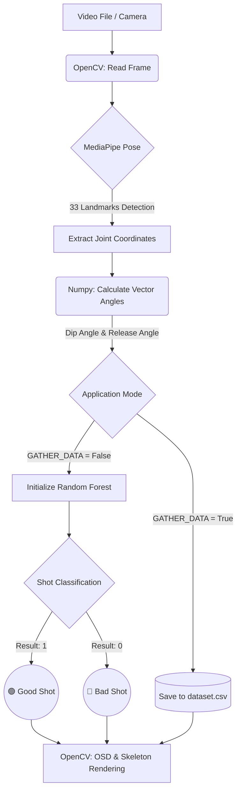

# 🏀 AI Basketball Pose & Shot Analyzer

A computer vision and machine learning-based analytical system designed to evaluate and improve basketball shooting mechanics. The application tracks the player's pose in real-time, analyzes the kinetic chain, and classifies the shot's form using an AI model.

---

## 📐 System Architecture

The following diagram illustrates the application's data flow, including its two main operational modes: **Gather Data** and **Inference**.



---

## 🛠 Technologies Used

The project is built using a modern Python technology stack, divided into four main pillars:

### 👁‍🗨 Computer Vision & Biomechanics
*   **OpenCV (`cv2`):** Processes the video stream, renders the On-Screen Display (OSD), and draws a dynamic skeleton directly on the video frames.
*   **MediaPipe (`mediapipe.solutions.pose`):** Google's advanced Deep Learning model for real-time body landmark tracking (pose estimation).

### 🧠 Machine Learning & Data Science
*   **Scikit-learn (`sklearn`):** Uses the `RandomForestClassifier` algorithm for binary shot classification (good/bad), optimized for class balancing.
*   **Pandas & Numpy:** Matrix manipulation, vectorization of 3D angle calculations (dot products), and dataset handling (DataFrames).
*   **Joblib:** Serialization (saving/loading) of the trained `.pkl` model for use in the main application.

### ⚙️ Tools and Architecture
*   **Python-dotenv:** Manages environment variables (file paths, operational modes) allowing for easy configuration without modifying the source code.
*   **Typing (`typing`):** Strict static typing (Type Hints) to improve code readability and safety.

### 🧪 Testing
*   **Pytest:** Unit testing framework used to verify the mathematical accuracy of algorithms (angle calculations), rendering functions, and the model training process.

---

## 📂 Project Structure

```text
├── src/
│   ├── main.py        # Main CV script: video analysis, MediaPipe, app logic
│   └── ml_model.py    # ML script: data loading, Random Forest model training & evaluation
├── test/
│   └── tests.py       # Unit test suite (angles, rendering, model verification)
├── .env               # Configuration variables (video, paths, mode, training params)
├── dataset.csv        # Collected shot data (dip, release, is_good)
└── model.pkl          # Saved, trained classifier model
```

---

## 🚀 Getting Started

### 1. Configuration (`.env`)
Create a `.env` file in the root directory to control the application's behavior:
```env
VIDEO_PATH=shot_video.mp4
DATA_SET_PATH=dataset.csv
MODEL_PATH=model.pkl
TEST_SIZE=0.2
RANDOM_STATE=42
```

### 2. Model Training
If you already have data collected in `dataset.csv`, run the training process:
```bash
python src/ml_model.py
```
The script will evaluate data quality, train the `RandomForestClassifier`, display metrics (Accuracy, Confusion Matrix), and save the model as `model.pkl`.

### 3. Video Analysis (Inference)
Make sure the `GATHER_DATA` variable in `src/main.py` is set to `False`. Then run:
```bash
python src/main.py
```

### 4. Unit Testing
To verify the stability of the mathematical functions and models, run:
```bash
pytest test/tests.py
```